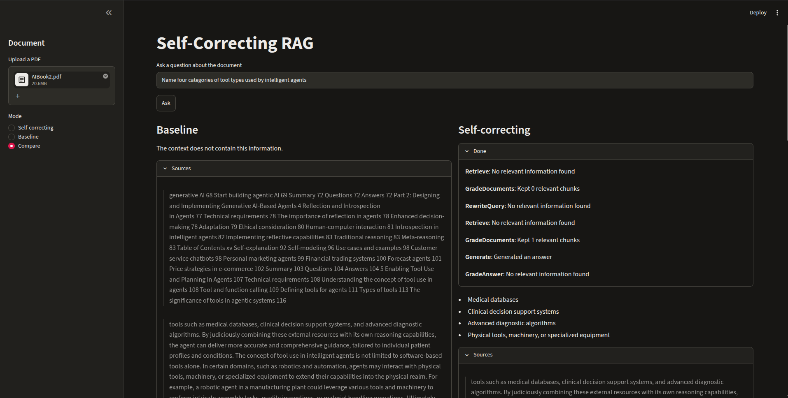
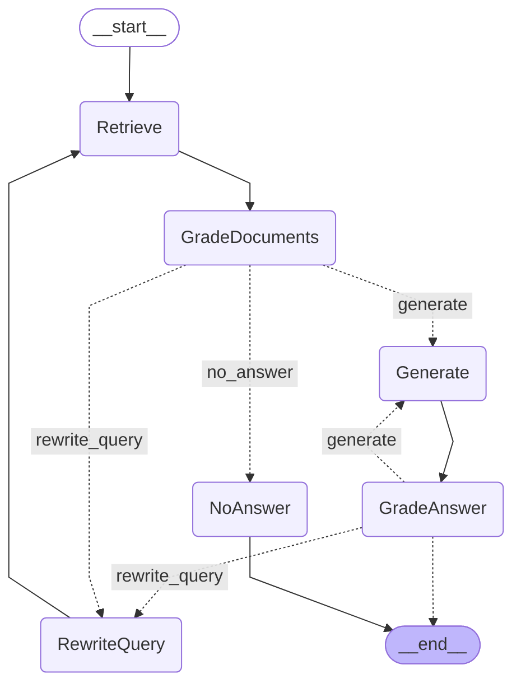

# Self-Correcting RAG

A question-answering system over your own PDF that **checks its own work**. It grades the retrieved chunks, rewrites the search query when retrieval fails, and verifies that the final answer is grounded in the document, retrying when it is not. Built with **LangGraph**, evaluated with **RAGAS**, and served through a **Streamlit** app that shows each step live.



## Why this project

A plain RAG pipeline retrieves chunks and answers, even when the chunks are irrelevant. It sounds confident and can be wrong. This project adds feedback loops around that pipeline and **measures** whether they help, instead of assuming they do.

## How it works



| Node | What it does |
|---|---|
| **Retrieve** | Fetches the top 7 chunks from the vector store. |
| **GradeDocuments** | Keeps only the chunks relevant to the question. If none survive, it routes to a rewrite, or goes to `NoAnswer` once the retry limit is reached. |
| **RewriteQuery** | Rewrites the question as a better search query, then retrieves again. |
| **Generate** | Writes the answer from the kept chunks. On a retry it also receives feedback about what was unsupported. |
| **NoAnswer** | Fallback when no relevant chunks are found after the retries: returns "I couldn't find this in the document." instead of guessing. |
| **GradeAnswer** | Checks that the answer is *grounded* in the chunks and *useful* for the question. Not grounded: regenerate with feedback. Not useful: rewrite the query. |

Retries and regenerations are capped so the loop always ends (see `Correction/Graph.py`).

## Models

All LLM calls go through the free **Groq** API.

| Role | Model |
|---|---|
| Generate, GradeAnswer | `openai/gpt-oss-120b` |
| GradeDocuments, RewriteQuery | `openai/gpt-oss-20b` |
| Embeddings (local) | `sentence-transformers/all-MiniLM-L6-v2` |

Vector store: Chroma. Chunking: 1000 characters with 200 overlap, top-k = 7.

## Features

- Upload any PDF and ask questions about it.
- **Self-correcting** mode with a live trace of every node that runs.
- **Baseline** mode (plain retrieve and generate) for comparison.
- Sources shown under every answer.
- Dockerized, CPU-only, embedding model baked into the image.
- Optional LangSmith tracing.

## Evaluation

The pipeline is scored with [RAGAS](https://docs.ragas.io) on 50 questions with reference answers, covering 5 chapters of an AI textbook:

- **Faithfulness:** is every claim in the answer supported by the retrieved chunks?
- **Answer relevancy:** does the answer address the question?
- **Context precision:** are the relevant chunks ranked at the top?

| Version | Faithfulness | Answer relevancy | Context precision |
|---|---|---|---|
| Baseline (retrieve + generate, 7 chunks) | 0.85 | 0.72 | 0.86 |
| v2: + document grading | not run yet | not run yet | not run yet |
| v3: + answer grading and retries | not run yet | not run yet | not run yet |

Notes on the method:

- A small local judge (`qwen2.5`) gave **false zeros** on answers that were actually supported. I re-scored the 14 zero-faithfulness rows with a stronger Groq judge (`gpt-oss-120b`); 13 of them became 0.67 to 1.0. The faithfulness figure above includes this correction (0.60 before it). The remaining zero is a genuine retrieval failure.
- Relevancy and precision come from the original judge run. The scores are only comparable between runs that use the same judge, questions and settings.
- Answer relevancy scores refusals ("the context does not contain this") as 0, which lowers the average when retrieval fails.
- The evaluation dataset is **not included** in this repository because it contains passages from a copyrighted book. `RAGAS/build_eval.py` rebuilds it for your own PDF.

## Quick start

### With Docker

```bash
git clone https://github.com/Mohamed-Amine-Sassi/SelfCorrectingRAG.git
cd SelfCorrectingRAG
cp .env.example .env        # then add your GROQ_API_KEY
docker compose up --build
```

Open <http://localhost:8501>, upload a PDF in the sidebar and ask a question.

### Without Docker

```bash
python -m venv .venv && source .venv/bin/activate
pip install torch --index-url https://download.pytorch.org/whl/cpu
pip install -r requirements.txt
cp .env.example .env        # then add your GROQ_API_KEY
streamlit run WebApp.py
```

Python 3.12. A free Groq API key is available at <https://console.groq.com>.

### Environment variables

| Variable | Required | Purpose |
|---|---|---|
| `GROQ_API_KEY` | yes | Groq API access |
| `LANGSMITH_TRACING` | no | `true` to trace runs in LangSmith |
| `LANGSMITH_API_KEY` | no | Needed only if tracing is on |
| `LANGSMITH_PROJECT` | no | LangSmith project name |

## Project structure

```
.
├── WebApp.py            # Streamlit app
├── RagCore.py           # build_vectorstore, run_baseline, run_with_trace
├── Correction/          # LangGraph pipeline
│   ├── Graph.py         # graph definition and routing
│   ├── RAGState.py      # shared state
│   ├── RetreiveNode.py
│   ├── GradeDocuments.py
│   ├── RewriteQuery.py
│   ├── GenerateNode.py  # Generate and NoAnswer nodes
│   ├── GradeAnswer.py
│   └── DecisionNodes.py # conditional routing functions
├── RAGBase/             # plain RAG building blocks
│   ├── Extracting.py    # PDF text extraction
│   ├── Chunking.py
│   ├── Embedding.py
│   ├── Retrieve.py
│   └── Generate.py
├── RAGAS/               # evaluation scripts
├── Dockerfile
├── docker-compose.yml
└── requirements.txt
```

## Limitations

- An answer that is split across two chunks can be missed by retrieval, and the pipeline then refuses to answer. Larger chunks, more overlap or neighbour-chunk expansion would help.
- Answer grading is done by an LLM, so it can be wrong or inconsistent.
- The self-correcting mode makes several LLM calls per question, so it is slower and uses more of the Groq free-tier quota than the baseline.
- Uploads are limited to 20 MB. Indexes of uploaded documents are kept on disk until the Docker volume is removed.
- English documents only. For other languages, swap the embedding model for a multilingual one.

## Copyright

The textbook used for development and evaluation is not distributed with this repository. Bring your own PDF.

## Author

**Mohamed Amine Sassi**: [GitHub](https://github.com/Mohamed-Amine-Sassi)

## License

<!-- Choose a license (for example MIT) and add a LICENSE file. -->
